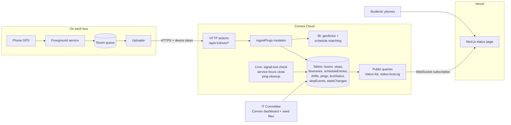

# Architecture — DAUST Bus Tracker

| | |
|---|---|
| **Version** | 1.0 (prototype) |
| **Last Updated** | 2026-10-19 (reconciled with grilling decisions) |

> Design decisions are recorded in `CONTEXT.md` and `docs/adr/`. Where this doc and
> `CONTEXT.md` disagree, `CONTEXT.md` wins.

## 1. Overview

The system is a small **serverless monolith** with two clients. All business logic (geofencing, timetable matching, status derivation) lives in one place: Convex backend functions. The driver app is deliberately "dumb": it collects good GPS points reliably and uploads them; it makes no decisions. The student page is a thin, read-only, real-time view.

Key choices:
- **Native Kotlin driver app** for maximum control over background execution (foreground service, battery-optimisation exemption, offline queue).
- **Write path over HTTP, read path over real-time subscriptions.** The phone posts batches of positions to Convex HTTP actions; the web page subscribes to Convex queries and updates automatically when data changes.
- **Server-side detection.** Arrival logic runs on the server so radii, dwell times and timetables can change without updating any phone.
- **Pure logic modules.** Geofence and schedule-matching code are pure TypeScript functions with no database access, so they are unit-tested with recorded GPS traces.
- **Store the derived state.** Each bus has one `busStatus` document, updated on every ping; the student page reads 4 small documents, not raw pings.

## 2. System Diagram

## 3. Components

### 3.1 Driver app (Android)
- **Purpose:** Turn a driver's phone into a reliable bus tracker during service hours.
- **Key screens:** Pairing (enter device token) · Shift (start/stop, selected itinerary, last upload) · Bus state (out of service + reason) · Setup checklist (permissions, battery exemption, brand tips).
- **Framework:** Kotlin, Jetpack Compose, Fused Location Provider, foreground service (`foregroundServiceType="location"`), Room, OkHttp, DataStore + Android Keystore for the token.
- **Key responsibilities:**
  - Request location updates at 10 s interval / high accuracy while on shift
  - Drop points with accuracy > 50 m
  - Write every point to the Room queue first, then upload in batches of up to 50
  - Retry with exponential backoff; never lose points while offline (24 h cap)
  - Send a heartbeat with battery level and app version
  - Auto-stop at the end of service hours from the config received at shift start
- **Distribution:** Signed APK installed by the IT Committee (not on the Play Store).
<!-- assumed: sideloaded APK avoids Play Store background-location review for an internal tool -->

### 3.2 Backend (Convex)
- **Purpose:** Single source of truth and all business logic.
- **Key entry points:**
  - HTTP actions: `POST /api/v1/driver/pair`, `POST /api/v1/driver/shifts`, `POST /api/v1/driver/pings`, `POST /api/v1/driver/shifts/end`, `PATCH /api/v1/driver/state`, `GET /api/v1/driver/config`, `GET /api/v1/status`
  - Public queries: `status.list`, `status.busLog`, `stops.list`
  - Internal mutations: `ingest.ingestPings`, `shifts.*`, `devices.provision`, `seed.loadAll`
  - Crons: `checkSignalLost` (every minute), `closeShiftsAfterHours` (every 15 min), `purgeOldPings` (daily)
- **Framework:** Convex (TypeScript), schema in `convex/schema.ts`.
- **Key responsibilities:** authenticate devices; validate and store pings; run the geofence state machine; match arrivals/departures to timetable entries; derive bus status; record state changes; expose real-time read models.

### 3.3 Student web app (Next.js)
- **Purpose:** Show the live status of every bus.
- **Key pages:** `/` (status list) · `/map` (map of buses and stops) · `/bus/[code]` (today's log for one bus) · `/about` (how it works, what "late" means).
- **Framework:** Next.js App Router, TypeScript, Convex React client, Leaflet + OSM tiles, Tailwind CSS.
- **Key responsibilities:** subscribe to `status.list`; render status lines with relative times that tick every second on the client; mark stale data; load fast on slow networks (static shell, small bundle, map loaded only on `/map`).

### 3.4 Database (Convex document store)
- **Purpose:** Reference data (stops, buses, itineraries, timetables, config), operational data (shifts, pings, stop events, state changes) and read models (`busStatus`).
- See `DATABASE_SCHEMA.md`.

## 4. Key Data Flows

### Flow 1 — Driver starts a shift
1. Driver taps **Start shift** and picks an itinerary.
2. App calls `POST /api/v1/driver/shifts` with the device token.
3. Convex checks the token → bus, checks service hours, creates a `shifts` row, sets `busStatus.serviceStatus = in_service`, anchors `nextEntryId` to the first entry at/after now, returns config (stops, schedule, thresholds, service end time). **The config is frozen into this shift** — later dashboard edits apply only to the next shift, never retroactively.
4. App starts the foreground service; the notification "DAUST Bus Tracker — on shift" appears.

### Flow 2 — A position arrives (core flow)
1. Service receives a location; if accuracy ≤ 50 m, inserts it into the Room queue.
2. Uploader sends a batch to `POST /api/v1/driver/pings`.
3. HTTP action authenticates the device and calls `ingest.ingestPings` (one transaction).
4. For each point in time order: store in `pings`; feed the geofence state machine (`lib/geofence.ts`) with the bus's current geofence state and the itinerary's stops. An **arrival** fires when the bus is inside the entry radius **and at rest** (`speed` below `stopSpeedThreshold` for `restConfirmPings`), with `dwellSeconds` as the fallback when speed is unavailable. Overlapping radii are disambiguated by `nextEntryId` (the expected stop wins).
5. If the machine emits `ARRIVED` or `DEPARTED`: `lib/schedule.ts` matches it **sequence-forward** — the earliest unvisited entry for that stop (`nextEntryId`) — computes the delay, and inserts a `stopEvents` row. An arrival landing *ahead* of `nextEntryId` auto-advances past the skipped entries, logging each `undetected`.
6. `lib/status.ts` derives the new `busStatus` (`serviceStatus`/`motion`/`connectivity`, last/next stop, next scheduled time, delay) and patches the document.
7. Every student page subscribed to `status.list` re-renders within about a second.

### Flow 3 — A bus goes silent
1. Cron `checkSignalLost` runs every minute.
2. For every bus on shift with `lastPingAt` older than 5 min: set `connectivity = signal_lost` (operational `serviceStatus` is left untouched), insert a `stateChanges` row, and call the `onSignalLost` notifier hook.
3. In v1 the alert surface is the **health view only** (the `onSignalLost` hook is a no-op stub, wired so a Telegram/email webhook can be switched on by config if the pilot shows missed failures — see ADR/CONTEXT). The student page shows "Signal lost — last seen at Wardini, 6 min ago". The next valid ping restores `connectivity` and re-anchors `nextEntryId`.

### Flow 4 — Bus is running late before it arrives
1. `status.list` computes, for each bus, the next timetable entry it has not reached.
2. If the current time is past that entry's arrival time + grace, the line shows "Running late · due 14:00 at Wardini · 7 min late", together with its live position.

### Flow 5 — Driver marks the bus out of service
1. Driver opens **Bus state**, picks "Out of service" and a reason.
2. App calls `PATCH /api/v1/driver/state`; Convex sets `serviceStatus = out_of_service` with the reason and records the state change; `motion`/`connectivity` tracking keeps running.
3. Students see "Out of service — mechanical issue".

## 5. External Services

| Service | Purpose | Notes / Cost |
|---|---|---|
| Convex Cloud | Database, backend functions, real-time sync, crons | Free tier is enough for 4 buses: about 4 × 6 pings/min × 12 h ≈ 17k writes/day; check limits monthly |
| Vercel | Hosting the Next.js page | Hobby tier free; move to a school-owned account before handover |
| OpenStreetMap tiles | Map background | Free; respect usage policy (attribution, low traffic) |
| Google Play Services (on phones) | Fused Location Provider | Free; requires Play Services on driver phones |
| Mobile data (drivers) | Upload positions | ~20–40 MB/month per phone; school top-up proposed |

<!-- assumed: Convex free tier limits are sufficient for prototype volume; verify against current Convex pricing -->

## 6. Scalability Notes

**Current constraints**
- 4 buses, a few hundred students: load is tiny; the main limits are data quality and phone reliability, not servers.
- `pings` grows ~17k rows/day; kept 30 days, then purged (stop events are kept permanently).
- Geofence matching loops over stops of one itinerary (< 15), so cost per ping is constant.

**Path to scale**
- More buses or campuses: no design change; add buses and stops as data.
- Higher ping frequency: batch uploads already cap request count.
- Coordinator panel (v2): new authenticated Next.js routes using Convex auth with a `coordinator` role, writing to the same tables.
- Notifications (v2): web push from a Convex action triggered by `DEPARTED` events.
- If phones prove unreliable, dedicated GPS trackers can post to the same `/pings` endpoint; the backend does not care what device sends the data.
